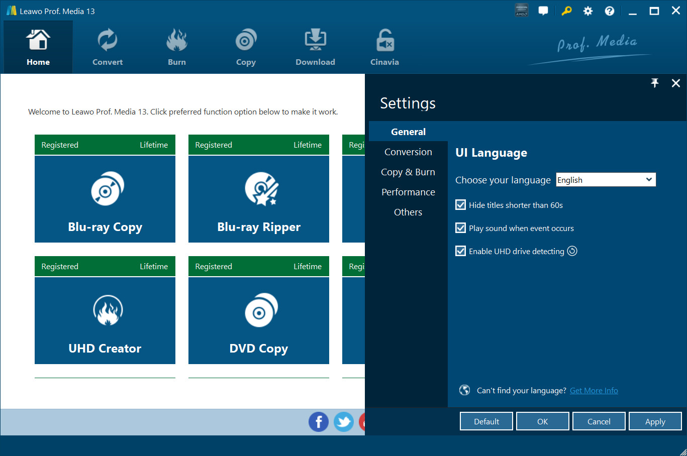
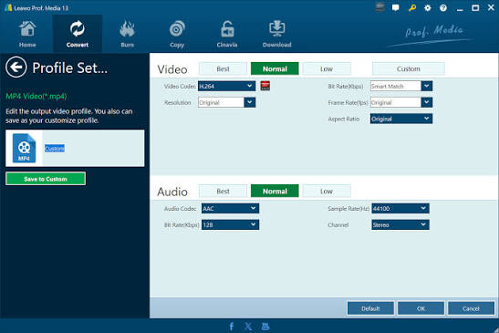

# Leawo Prof. Media Connects Files and Discs

A family recording can become a smaller playback file, a disc with a navigable menu, or an image retained for another burn.
Those results require different operations even when the same source video is involved.
This leawo prof media guide helps you choose the route before adjusting quality, tracks, or destination settings.

## Pick the Operation by the Result You Need

Within the leawo prof product family, conversion, copying, and authoring serve different purposes.
Check the modules included in your license and platform before committing to a workflow.

- **Create a playback file:** use conversion when the result should be an ordinary video or audio file.
- **Retain disc content:** use the appropriate copy operation when disc structure is part of the result.
- **Build a new disc project:** use authoring when source clips need titles, chapters, and a disc menu.
- **Make a photo presentation:** use the slideshow workflow when a sequence of pictures should become a video.

Keep the source material until the result has been checked in its intended player.
A successful export and a disc that navigates correctly are different completion criteria.

[](https://leawo-prof-media.github.io/Leawo-Prof/)

## Build a Home-Video Disc around Its Navigation

In the leawo prof media suite, a disc project starts with decisions about what the viewer should be able to select.
Put clips in the desired order and give them names that make sense on a television screen.
Choose the target disc type and review the available capacity before adding decorative menu elements.

Leawo's [disc authoring guide](https://www.leawo.com/guide/total-media-converter-ultimate/burn-video-to-dvd-blu-ray.html) explains its Burn panel, menu gallery, and output choices.
Preview the title page and chapter pages as navigation, rather than judging only the background image.
If a menu is unnecessary, use the workflow's supported option for omitting it.

- Check title order and chapter destinations.
- Keep menu text readable at the expected viewing distance.
- Review the chosen aspect ratio and subtitle presentation.
- Confirm that the target disc format matches the playback equipment.



For a long program, extra runtime and multiple tracks compete for the available space.
Inspect the project's capacity estimate after changing quality or adding content.
Retain an output folder or image when you expect to prepare additional physical copies later.

## Keep Track Choices Attached to the Right Title

A disc can contain several titles, languages, or subtitle tracks.
Preview the selected title and sample its beginning, middle, and end before creating a long conversion job.
Confirm the intended language instead of relying only on the first audio track in the list.

Use the [editing controls](https://www.leawo.com/guide/total-media-converter-ultimate/video-editing.html) to trim unwanted footage or adjust a visible framing problem.
Cropping changes the picture's boundaries, while resizing changes its pixel dimensions.
Review captions near the picture edges after either operation.

For a photo slideshow, arrange the images before choosing a destination format.
Watch transitions and check whether portrait photographs remain legible within the selected frame.
Treat the slideshow video and a disc made from it as separate outputs to verify.

## Join Compatible Recordings without Another Encode

When recordings already have matching stream properties, an independent FFmpeg workflow can join them without re-encoding.
This can be useful before importing a combined home recording into a larger project.
FFmpeg's [concat demuxer](https://ffmpeg.org/ffmpeg-formats.html#concat) requires matching streams, codecs, and time bases.

Create a UTF-8 file without a byte-order mark, named parts.ffconcat, beside the two example recordings:

```text
ffconcat version 1.0
file 'part-one.mkv'
file 'part-two.mkv'
```

With FFmpeg available, this Bash command reads the list and writes a separate joined file:

```bash
ffmpeg -f concat -safe 1 \
  -i "parts.ffconcat" \
  -map 0 -c copy "joined-recording.mkv"
```

Replace the example filenames with compatible recordings and keep their originals.
Stream copying preserves the encoded streams; it does not make mismatched inputs compatible.
This list format belongs to FFmpeg and is not presented as a Leawo project file.

## Choose File Quality Separately from Disc Capacity

A playback copy can prioritize device compatibility, storage size, or detail.
A disc project also has format and capacity requirements that a generic video profile does not describe.
Use a short sample to compare settings before processing an entire recording.

| Result | What it contains | Useful review | What it does not establish |
| --- | --- | --- | --- |
| Converted video file | Selected encoded video and audio streams | Playback, synchronization, and picture detail | A navigable authored disc |
| Authored disc folder | A structured disc project output | Title selection, chapters, and menus | A successful physical burn |
| ISO image | A disc image for supported image workflows | Expected contents and playback support | Compatibility with every standalone player |
| Burned optical disc | The project written to physical media | Playback in the intended equipment | An independent backup of the source files |

For a review copy, an independently installed [FFmpeg](https://ffmpeg.org/ffmpeg.html) build with libx264 can encode H.264 video and AAC audio.
This Bash example selects the first video stream and an optional first audio stream:

```bash
ffmpeg -i "source-recording.mov" \
  -map 0:v:0 -map "0:a:0?" -c:v libx264 -preset medium -crf 22 \
  -c:a aac -b:a 192k -movflags +faststart "review-copy.mp4"
```

This command re-encodes the selected streams and is not a DVD or Blu-ray authoring command.
Compare the output with the source around movement, gradients, and small lettering.

The supplied Leawo profile screenshot, [foto1.jpg](fairy/foto1.jpg), shows separate video and audio controls.
As FFmpeg reference material, [libvpx-360p.ffpreset](presets/libvpx-360p.ffpreset) and [libvpx-720p.ffpreset](presets/libvpx-720p.ffpreset) illustrate another encoder's recorded settings.
The [libvpx-1080p.ffpreset](presets/libvpx-1080p.ffpreset) file supplies a further comparison.
Its companion [libvpx-720p50_60.ffpreset](presets/libvpx-720p50_60.ffpreset) and [libvpx-1080p50_60.ffpreset](presets/libvpx-1080p50_60.ffpreset) files include different look-ahead settings.
These FFmpeg presets should not be treated as directly importable Leawo profiles.



## Check the Module Bundle before Comparing Editions

The phrase leawo prof media 16-in-1 appears in the vendor's user guide, while the product page currently lists 17 included products.
Use the actual module list, operating system, and license terms when comparing offers.
The older name leawo total media converter ultimate also appears in product URLs and documentation.

The supplied [foto2.jpg](fairy/foto2.jpg) shows the Home screen with General settings open.
Its visible module registration labels describe that captured session, not the entitlement of every installation.
Consult the [official product page](https://www.leawo.com/pro/total-media-converter-ultimate.html) for current packaging and platform details.

## Understand the Accompanying Technical References

The source selection contains FFmpeg build support and presets, supplied as comparison material rather than Leawo Prof. Media source code.
It is a partial checkout, and the examples above assume an independently available FFmpeg executable.
The two supplied screenshots show Leawo's interface; they do not make the FFmpeg fragments part of Leawo's published implementation.

The FFmpeg [Changelog](Changelog) records changes, while [project_facts.md](fairy/project_facts.md) describes implementation and test conventions.
The [configure](configure) script detects build capabilities; [arch.mak](ffbuild/arch.mak) selects architecture-dependent object groups.
Shared rules appear in [common.mak](ffbuild/common.mak), and [library.mak](ffbuild/library.mak) handles library build details.
The [bin2c.c](ffbuild/bin2c.c) helper turns binary input into a C representation.
Version support is split between [libversion.sh](ffbuild/libversion.sh) and [version.sh](ffbuild/version.sh).
The [pkgconfig_generate.sh](ffbuild/pkgconfig_generate.sh) script produces pkg-config metadata, and [.gitignore](ffbuild/.gitignore) lists generated build artifacts.

### Brief and Repository Layout

The supplied [Leawo Prof. Media.txt](Leawo%20Prof.%20Media.txt) contains the product brief and search phrases.
The separate [New Text Document.txt](New%20Text%20Document.txt) is an unfilled keyword-input template.
For these links, place the source folder's contents at the repository root and include those two existing documents alongside them.
Preserve the nested reference paths when preparing the repository contents.

## Related Search Terms

leawo prof media, leawo prof, leawo prof media suite, leawo prof media 16-in-1, leawo total media converter ultimate, video, audio, multimedia, video-transcoding, mp4, matroska, hevc, h264, mpeg, multi-platform
